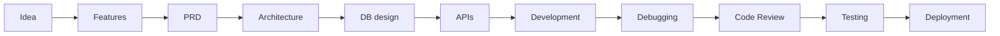

> **Season 2 — AI Native Software Engineer** [🔗](./README.md)

# Episode 01: Fundamentals of Building with AI

> Season 2 shifts from *understanding* AI to *building* real products with it — walking the full software development lifecycle from ideation to deployment, choosing the right AI tools and models, and learning to understand the process instead of copying prompts.

---

<strong style="font-size: 1.25em;">👀 At a Glance</strong>

| Question | Short answer |
|:---|:---|
| What is Season 2 about? | Building a real, end-to-end product with AI tools — from idea to deployment |
| What is the biggest mistake to avoid? | Pasting one giant prompt and expecting a working product — skip the software engineering steps and AI returns garbage |
| Is code written by hand? | No — AI does ~99% of the coding, to explore what AI can actually build |
| Which tool is used? | Codex (OpenAI), but the same process works in Cursor, Claude Code, Antigravity, or any tool you prefer |
| Do I need a premium subscription? | For the coding tool, yes — free limits are too small for real development. Free alternatives exist for other steps |
| What tech stack? | A full-stack web app, but the fundamentals apply to any stack |

---

<strong style="font-size: 1.25em;">📝 Quick Notes — visual revision</strong>

| | |
|:---|:---|
|  |  |
|  |  |

---

<strong style="font-size: 1.25em;">🎯 The Season's Goal: Build a Real Product with AI</strong>

🚀 Season 2 is all about **practical implementation**. Instead of learning concepts in isolation, you will build a real-world product and watch the entire development process unfold — from the first idea all the way to a deployed, live application.

🧱 The single most important warning: **the biggest mistake people make is writing one very long prompt and expecting the product to magically appear the way they imagined it.** It will not. If you skip the software engineering steps, AI will hand you a pile of garbage code. The whole point of this season is to show the *right* way to build a product today — not "one prompt, magic result."

👥 This season is designed for **everyone**, not just experienced developers:

| | |
|:---|:---|
| - Software engineers who want to level up with AI | - College students new to development |
| - People from product management | - People from DevOps and QA |
| - Engineering managers | - Anyone curious about what AI can build |

> **The goal is confidence.** After this season, you should feel confident that you can build a real, industry-level project on your own — with AI doing most of the heavy lifting.

---

<strong style="font-size: 1.25em;">🔄 The Software Development Lifecycle (SDLC)</strong>

🗺️ Building software follows a well-known process called the **Software Development Life Cycle (SDLC)**. These steps have existed long before AI — the only difference now is that AI writes the code instead of you typing every line by hand.

Here is what each stage means in plain words:

| | |
|:---|:---|
| **Idea** - Decide what you actually want to build | **DB design** - Plan how your data is stored |
| **Features** - List the features, then break them into smaller sub-features | **APIs** - Define the backend endpoints |
| **PRD** - Write the Product Requirements Document | **Development** - Use AI to build the features |
| **Architecture** - The technical plan (which languages, frameworks, and tools) | **Debugging** - Find and fix the bugs (there will be bugs) |
| | **Code Review** - Let AI review the code it wrote |
| | **Testing** - Run the different types of tests |
| | **Deployment** - Put the product on a real domain/website |

### PRD and Architecture

📄 The **PRD (Product Requirements Document)** is where you finalise the requirements — you write down, in a document, everything you want your software to do. In a company, product managers usually write the PRD, and engineers then read it and design the system.

🏛️ The **architecture document** is the technical side: it decides things like "should we use Node.js or Java?" If you are non-technical, do not worry — AI is very capable of making good calls about databases, APIs, and architecture, and you will see that happen in the coming episodes.

### Design goes hand in hand with development

🎨 **UI design** is not a separate afterthought — it goes hand in hand with development. Before you write code, you should be able to visualise how the product looks: where the sign-up button goes, what the home page looks like, how the feed is laid out. Build the design first, then add the code.

---

<strong style="font-size: 1.25em;">🤖 The AI-First Approach: Rely on AI, Not Hand-Written Code</strong>

🧑‍💻 I am a full-stack software engineer with about a decade of industry experience — I can write every line of this project by hand. But in this season I deliberately **step back and do not act like a software engineer**. I rely on AI almost 99% of the time, only stepping in to fix things when AI gets stuck.

> **Why?** Because the point is not to show off hand-coding. The point is to explore the *potential* of AI — to see what you can actually build when you let AI do the work.

🔮 My view on the future: the future of software engineering is **not staring at a screen typing code** — it is **instructing and guiding AI** to build what you need. Even at large companies, I have observed that engineers have largely stopped writing code by hand.

📌 A few honest caveats worth setting up early:
- **AI is not 100% correct every time.** You will see it mess up, and you will learn how to handle those moments.
- **AI is not replacing software engineers** — it is *empowering* them to build more.
- **You cannot prepare the content in advance.** Every prompt generates a new result, so the journey is live and unscripted.

---

<strong style="font-size: 1.25em;">🧰 Tools, Models & Subscriptions</strong>

🛠️ There are many AI coding tools in the market — **Codex** (OpenAI), **Cursor**, **Claude Code**, **Antigravity** (Google), and more. I use **Codex**, but the process works in *any* of them. Pick the tool you like; the SDLC fundamentals are the same.

> **Go beyond the tool.** The software development lifecycle is what matters, not which app you open. If you use Claude Code, use Claude Code. If you use Cursor, use Cursor.

### Use the best available model

🏆 The one rule that really matters: **whenever you use a tool, use the best model available in that tool.** A better model gives you better output. I am using the top model in Codex, and for Claude-based tools, **Opus is stronger for coding than Sonnet**.

> ⚠️ Needs verification: the exact model version names are garbled in the source transcript (referred to as a "5.6" model in Codex, "Opus 4.6", and "Sonnet"). Check the current best model in your tool of choice.

### Should I buy a premium subscription?

💳 For the **coding tool**, yes — a premium subscription is strongly recommended (for example, a ChatGPT Plus/Pro plan for Codex). The free limits are far too small for real development. A mid-tier plan is usually enough; you do not need the most expensive one.

🆓 For **other steps** (code review, testing, deployment), **free alternatives** are pointed out where they exist, so you do not have to pay for every single tool.

---

<strong style="font-size: 1.25em;">🏗️ The Tech Stack</strong>

🧱 For this project I am building a **full-stack web application** — front end and back end together. I chose a full-stack setup because it is a strong, widely-used stack that is easy to set up and work with, and many learners are already familiar with it.

> **The knowledge is not locked to one stack.** Once you understand *how* to build the product, the same fundamentals apply to other stacks. A good homework idea: after finishing this project, rebuild it using a *different* tech stack.

_(The exact framework will be revealed as the series progresses.)_

---

<strong style="font-size: 1.25em;">⚡ Important Point: Everything Changes Fast — Understand, Don't Copy</strong>

🌪️ The AI space changes **very fast**. By the time you work through these notes, the tools, the UI, the settings, and the models may all look different from what is shown here. Do not panic if something does not match — **think beyond the tool and the tech stack.**

🔁 This connects directly to Season 1: an LLM is a **generative** model, so it produces a *new* response every time. That means:
- **You will not get the same results as me** — even with the exact same prompt.
- **Your bugs will be different** from my bugs.
- **Your code will be different** from my code.

> **Understand what is being done — do not copy it.** Do not mimic the prompts. Work through with an open mind, understand *why* each step is taken, and apply the same reasoning to your own (different) results.

🧭 The reassuring part: **the basic fundamentals never change.** The SDLC, the way products are built, and the software engineering principles are the same as they were before AI. Only the person typing the code has changed — from you, to AI.

🎨 And because every journey is different, **use your creativity.** If you want a feature to work a certain way, feel free to experiment. Building with AI is like getting a blank canvas — you can imagine and build whatever you want.

---

<strong style="font-size: 1.25em;">💡 My Mental Model</strong>

🧠 I think of this season like learning to be a **conductor instead of a musician**. In Season 1 I learned how the instruments (LLMs) work. Now I am not trying to play every note myself — I am learning how to *direct* AI to produce the piece I want, and how to notice when a note is off and guide it back.

🪜 The SDLC is my safety net. Even though AI writes the code, I still walk the same ladder — idea, requirements, architecture, build, debug, review, test, deploy. The ladder is old and reliable; only the hands climbing it are new.

🎲 And I keep one rule taped to my monitor: **my result will not match the video's result, and that is fine.** My job is to understand the *process*, not to reproduce the *output*.

---

## Key Takeaways

- **Season 2 is about building a real product end-to-end with AI** — from ideation to deployment, not isolated concepts. [🔗](#season-goal)
- **The biggest mistake is one giant prompt expecting a magic result** — skip the software engineering steps and AI returns garbage. [🔗](#sdlc)
- **The SDLC is the backbone**: Idea → Features → PRD → Architecture → DB → APIs → Development → Debugging → Code Review → Testing → Deployment. [🔗](#sdlc)
- **The instructor relies on AI ~99% of the time** — the goal is to explore AI's potential, not to hand-write code. [🔗](#ai-first-approach)
- **Use the best available model in whatever tool you choose** — the process is the same across Codex, Cursor, Claude Code, and Antigravity. [🔗](#tools)
- **A premium subscription is worth it for the coding tool**; free alternatives exist for other steps. [🔗](#tools)
- **Everything changes fast — understand the process, don't copy the prompts**, because your results will differ from the video's. [🔗](#everything-changes)

## Questions / Things to Explore

- What is the actual project idea we will build in this season? _(coming soon — Episode 02)_
- What does a good PRD look like in practice? _(coming soon)_
- How do you ask AI to review and improve its own code? _(coming soon)_
- What are the different types of testing we will cover? _(coming soon)_
- How do you deploy the finished product to a real domain? _(coming soon)_
- How does this AI-first workflow build on the LLM fundamentals from [Season 1, Episode 3](../season-1-inside-the-mind-of-ai/episode-03-does-chatgpt-know-or-does-it-guess.md)?

---

| ← Previous | Next → |
|:---:|:---:|
| [Season 2 README](./README.md) | Episode 02 _(coming soon)_ |
